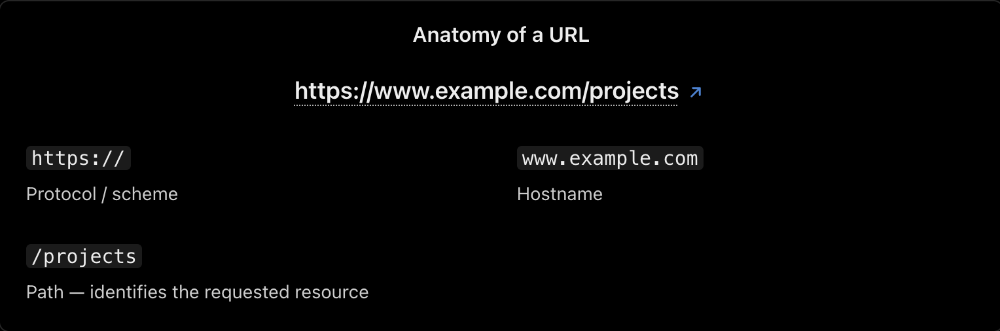
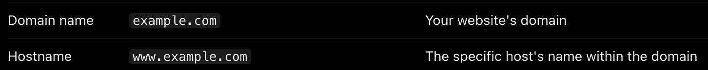

# Website Publishing and SEO Lifecycle

1. **Create the website**

   Write your pages, components, styles, and functionality using Next.js, React, HTML, CSS, and JavaScript.

2. **Deploy it to a server**

   Build the application and host it somewhere accessible over the internet.

3. **Connect a domain**

   Configure DNS so a domain such as example.com points to your hosting provider.

4. **Make pages accessible and crawlable**

   Configure HTTPS, HTTP responses, internal links, robots.txt, and your sitemap.

5. **Help Google discover your website**

   Verify the website in Google Search Console and submit your sitemap.

6. **Google crawls and indexes eligible pages**

   Googlebot visits pages, processes their content, and may add them to Google's search index.

7. **Google ranks and displays results**

   When someone searches, Google selects and orders relevant results for that query.

---

## What is hosting?

Hosting is a service or infrastructure that makes your website available on the internet so other people can visit it.

## What is a build?

A build is the process of preparing your application for deployment.

## What is deployment?

Deployment means publishing a version of your application to an environment where it can run.

## What is a domain name?

A domain is the human-readable address used to access a website.

**Domain — identifies your website.**

Ex: **www.example.com**

---

## What is SEO?

SEO stands for Search Engine Optimization.

It means improving your website so search engines can understand its content and people can find it through relevant searches.

SEO does not mean adding a few files and automatically reaching the first position on Google. It is an ongoing process of making your pages accessible, useful, relevant, and trustworthy.

## sitemap.xml — URL discovery

Lists the preferred public URLs you want search engines to discover. It can also provide metadata such as last modification dates.

Example URL: [https://example.com/sitemap.xml](https://example.com/sitemap.xml)

## robots.txt — Crawling instructions

Tells compliant crawlers which URL paths they may or may not request.

**robots.txt** is a text file placed at the root of your website that tells web crawlers which parts of your website they are allowed or asked not to crawl.

Example URL: [https://example.com/robots.txt](https://example.com/robots.txt)

## What is a canonical URL?

A canonical URL is the preferred version of a webpage when the same or very similar content is accessible through multiple URLs.

## What is Googlebot?

Googlebot is Google's web crawler. A crawler is an automated program that requests pages, follows links, and discovers content.

## What is crawling?

Crawling is when Googlebot visits a URL and retrieves its content.

## What is indexing?

After crawling and processing a page, Google may decide to include it in its search index.

Think of the index as a massive, organized database of information about eligible webpages.

## What is ranking?

Ranking is the process of determining which indexed pages are most relevant to a particular search and in what order they should appear.

## What is a SERP?

SERP stands for Search Engine Results Page.

It is the page Google displays after a user submits a search query.

## What is a search snippet?

A search snippet is the short description that may appear below a result's title and URL.

Google generates snippets automatically, often from the page's visible content. It may use your meta description if that description is useful for the query, but it does not have to use it.
